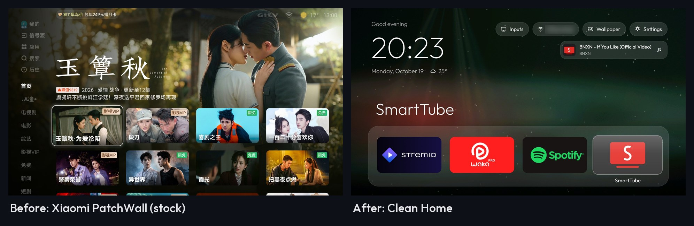
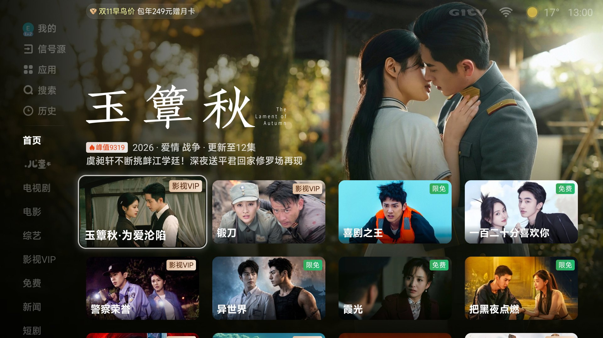
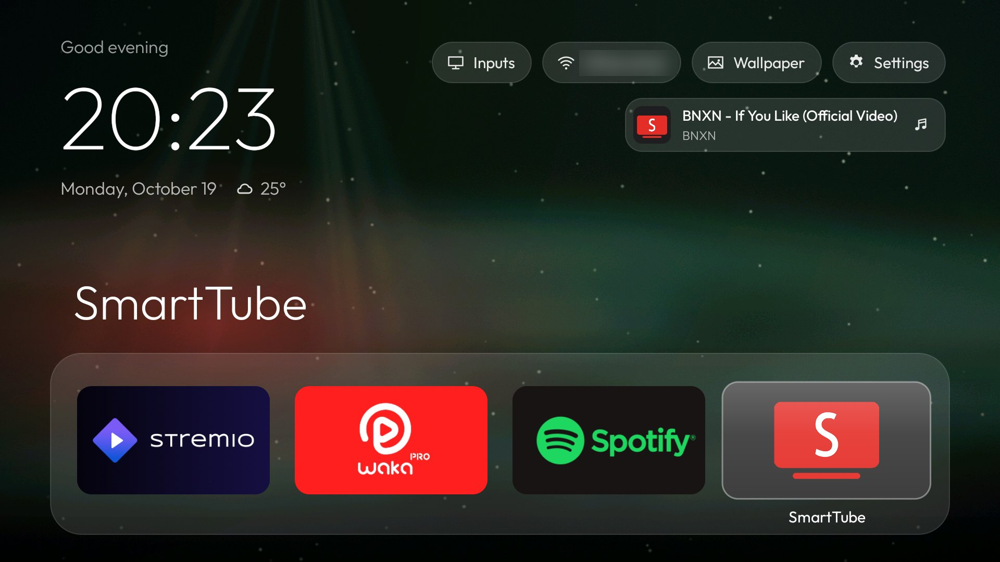
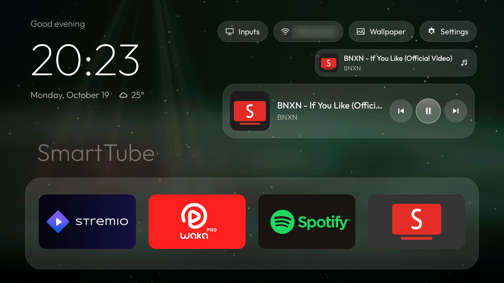
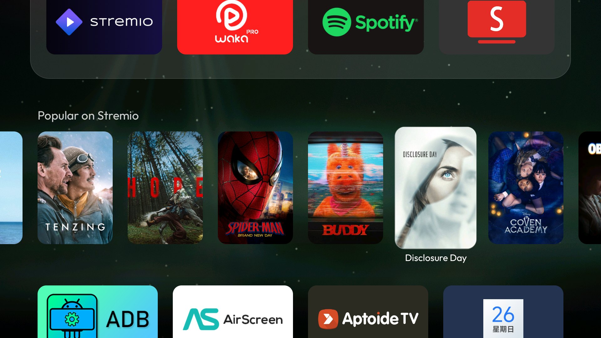
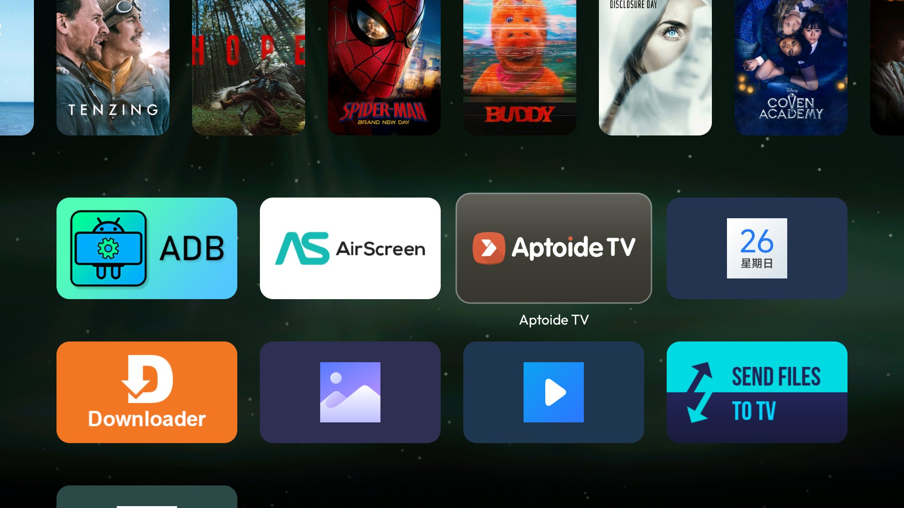
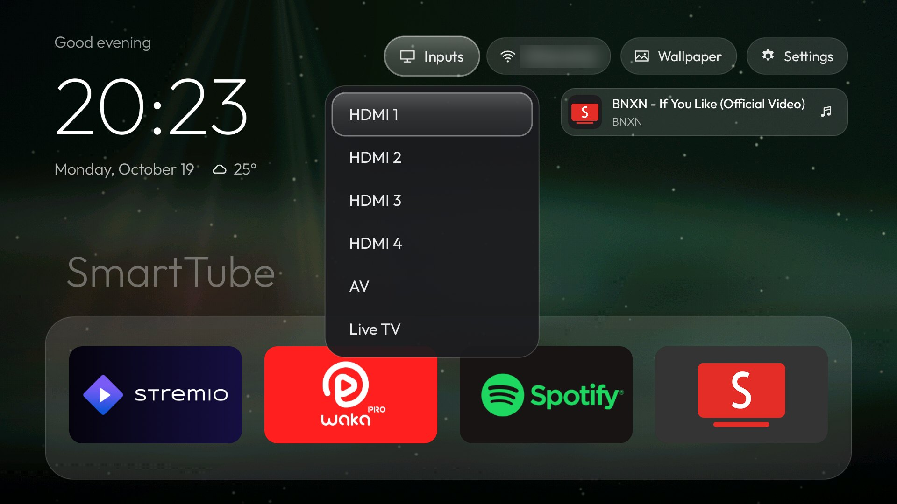
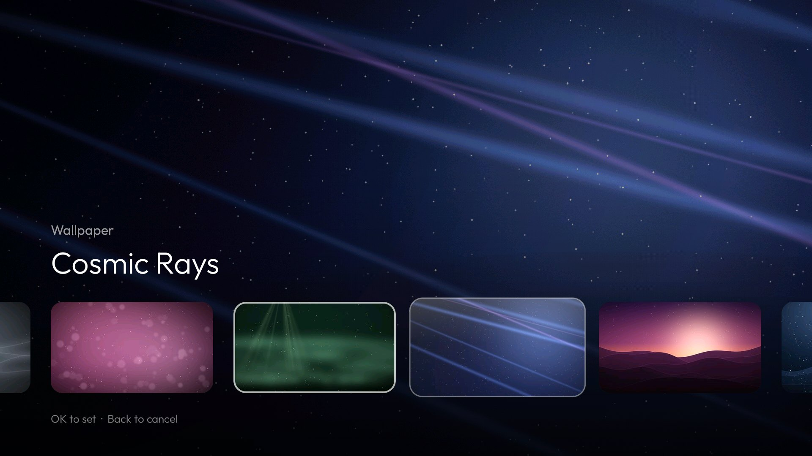
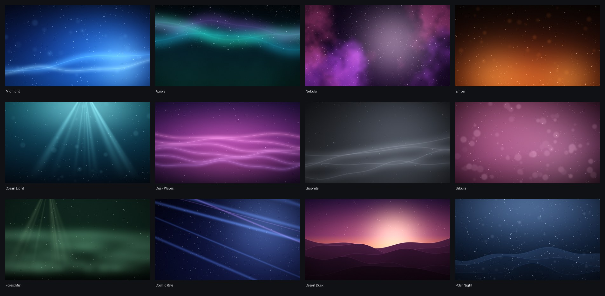

# Clean Home for Xiaomi Mi TV

**A fast, ad-free, Apple TV–style home screen for Xiaomi Mi TVs running HyperOS / Android 14, plus the scripts that debloat the TV and keep it that way.**



Xiaomi's stock PatchWall home is slow and full of ads and Chinese-market content. This project replaces it with **Clean Home**, a small native launcher built for a TV remote. It shows a clock, your four favourite apps, a row of popular movies from Stremio, all your other apps, and ambient wallpapers. Every screen above was captured on the real TV.

It was built and tested on a **Xiaomi Mi TV, model MiTV-MFTR0** (Chinese-market firmware, Xiaomi HyperOS 3 on Android 14, 4K panel); full specs are [below](#the-tv). Nothing is rooted, and every change can be undone.

---

## Before and after

| Before: Xiaomi PatchWall (stock) | After: Clean Home |
|---|---|
|  |  |

| | Stock PatchWall | Clean Home |
|---|---|---|
| **Home screen** | Chinese streaming catalogue, full-screen drama banner | Clock, weather and your own apps over an ambient wallpaper |
| **Ads and upsells** | "VIP" paywall badges and a sales promo pill | None |
| **Language** | Chinese only | English |
| **Your apps** | Behind the 应用 (Apps) menu | Dock for four favourites, plus a grid of the rest |
| **Inputs** | Behind the 信号源 (Source) menu | Inputs pill: HDMI 1–4, AV, Live TV |
| **Background services** | Telemetry, push, ads, shopping, cleaner and more | Disabled (and reversible), see [`debloat-list.txt`](debloat-list.txt) |
| **Network** | Loads its streaming catalogue, artwork and promotions | Only weather and the Stremio row, only when Home opens |

## Features

| | |
|---|---|
| **Clean home screen** | Large clock, greeting, date and local weather over an ambient wallpaper. The focused dock app's name glows in its own colour. |
| **Dock** | Four favourite apps in a frosted-glass band (Stremio, WakaTV, Spotify and SmartTube by default). |
| **Popular on Stremio** | Posters of Stremio's 20 most popular movies. OK opens the movie's page straight in Stremio. |
| **App grid** | Every other installed app, 4 per row, using each app's TV banner. |
| **Now Playing** | While music or video plays, a card under the top bar shows the artwork, title and artist, with previous / play-pause / next controls. |
| **Inputs** | One menu for HDMI 1–4, AV and Live TV. |
| **Wallpaper gallery** | 12 original ambient wallpapers in a PS5-like style, previewed full screen as you browse, or use your own photo. |
| **Made for the remote** | Every key press moves exactly one step, even with this TV's laggy Bluetooth remote. A glass highlight glides to whatever is focused. |
| **Light** | About 110 MB of memory with posters and wallpaper loaded, 0% CPU and no redraws while idle, and no background polling. Navigation renders with no dropped frames on the TV's Mali-G52 GPU. |
| **Takes over Home** | This ROM won't let a third-party app be the home screen, so the Home button is redirected by a small accessibility service (explained below). |

## Screenshots

| | |
|---|---|
|  **Home.** Clock, weather, top bar, Now Playing card and the dock. |  **Now Playing.** OK on the card opens the media controls. |
|  **Popular on Stremio.** Scrolls sideways; the title shows under the focused poster. |  **App grid.** Every other app, using their TV banners. |
|  **Inputs.** Switch between HDMI, AV and Live TV. |  **Wallpaper gallery.** Left/Right previews full screen, OK keeps it. |

The wallpaper pack, generated from code in [`tools/make-wallpapers.py`](tools/make-wallpapers.py):



## Remote control

| Where | Left / Right | Up | Down | OK | Back |
|---|---|---|---|---|---|
| **Top bar** (Inputs, Wi-Fi, Wallpaper, Settings) | Next pill | | Now Playing card, or the dock | Open it | Dock |
| **Now Playing card** | | Pill above | Dock | Media controls | Dock |
| **Dock** | Next app | Top bar | Popular on Stremio | Open the app | |
| **Popular on Stremio** | Scroll posters | Dock | App grid | Open in Stremio | Dock |
| **App grid** | Next app | Row above | Row below | Open the app | Dock |
| **Wallpaper gallery** | Preview the next wallpaper | | | Keep it | Cancel |

**Home** brings you back to the dock from anywhere. After you return from an app, the tile you used last is still focused.

## What's in this repository

```
launcher/            Clean Home launcher (Java, Android 14, ~2,600 lines, no frameworks)
install.sh           Build the launcher, install it, make it the home screen
debloat.sh           Disable the packages listed in debloat-list.txt
debloat-list.txt     The Xiaomi apps and services to disable (telemetry, ads, push, ...)
keyboard.sh          Swap the Chinese Sogou keyboard for Gboard
restore.sh           Undo everything: re-enable apps, put the stock home back
tools/tv.py          ADB client over the network (works around macOS adb issues)
tools/make-wallpapers.py   Generates the ambient wallpaper pack
tools/install-bundle.sh    Installs .apkm split-APK bundles
docs/                Setup guide, launcher internals, build notes, screenshots
```

Not in the repository: third-party APKs (`apks/`; sources and checksums are listed in the [setup guide](docs/SETUP-GUIDE.md#files)), per-TV settings backups (`backup/`), the ADB key, and the 1 GB local toolchain (`tools/jdk`, `tools/android-sdk`, ...).

## The TV

Everything here was built and tested on this set. These details come from
the TV's own system properties (`getprop`, `/proc/meminfo`, `wm size`):

| | |
|---|---|
| **Brand** | Xiaomi (Mi TV) |
| **Model** | `MiTV-MFTR0` (device codename `freeguy`, board `RZXJ`) |
| **Market** | Chinese-market firmware: PatchWall home, Chinese interface, GITV/iQIYI streaming |
| **Operating system** | Xiaomi HyperOS 3 (build `OS3.0.107.0.UFTMATV`) on **Android 14** (API 34), security patch 2025-07-05 |
| **Processor** | MediaTek MT9653 (platform `mt5879`), 4 CPU cores, 32-bit ARM apps only (`armeabi-v7a`) |
| **Graphics** | ARM Mali-G52, OpenGL ES 3.2 |
| **Memory / storage** | 4 GB RAM / 64 GB (about 54 GB available for apps and data) |
| **Display** | 4K panel (3840×2160). Android draws its interface at 1920×1080, 320 dpi, 60 Hz, as most 4K TVs do |
| **Remote** | Xiaomi Bluetooth voice remote |
| **Google services** | No Google TV / Play Store (the ROM blocks it); Google Play services are present |

**Check your own TV** with the network ADB tool:

```bash
tools/.venv/bin/python tools/tv.py shell "getprop ro.product.model; getprop ro.build.display.id; getprop ro.build.version.release"
```

**Will it work on another TV?**

- **Same model (MiTV-MFTR0, any screen size):** yes, everything works. The
  [new TV prompt](docs/NEW-TV-PROMPT.md) walks through setting up a second one.
- **Other Xiaomi TVs on HyperOS / Android 14:** probably. The Xiaomi-specific
  parts are the Home-button workaround, the standby whitelist and the input
  switching (which uses Xiaomi's `tvplayer`). Check `debloat-list.txt`
  against your TV's packages before running it.
- **Any other Android 14 TV:** the launcher itself installs and runs, since it
  only needs `minSdk 34`. Skip `debloat.sh`; on most TVs you can simply pick
  Clean Home as the home app. Inputs may need changes.

## Quick start

You need a Mac or Linux PC on the same network as the TV. Full details are in the [setup guide](docs/SETUP-GUIDE.md).

1. **Prepare the TV.** Connect it to Wi-Fi. Turn on Developer options (Settings → Device Preferences → About, press OK on *Build* 7 times), then turn on **USB debugging** and **network ADB debugging**. Note the TV's IP address.
2. **Prepare the computer.** Install JDK 17, the Android SDK (platform 34) and Python 3.12. Then set up the Python tools:
   ```bash
   python3 -m venv tools/.venv
   tools/.venv/bin/pip install -r tools/requirements.txt
   ```
   See [docs/BUILDING.md](docs/BUILDING.md) for the toolchain.
3. **Debloat and install** (replace the IP with your TV's):
   ```bash
   TV_IP=192.168.1.232 ./debloat.sh
   TV_IP=192.168.1.232 ./install.sh
   ```
   The first command makes the TV ask *"Allow USB debugging?"*. Tick *Always allow* and press Allow.
4. **Press Home** on the remote. Clean Home opens, and it will open at every boot.

To undo everything: `./restore.sh` puts back every disabled app and the stock Xiaomi home.

## Customising

| What | How |
|---|---|
| **Dock apps** | Edit `dock_apps` in [`config.xml`](launcher/app/src/main/res/values/config.xml), then `./install.sh`. |
| **Hidden apps, display names** | `hidden_apps` and `label_overrides` in the same file. |
| **Wallpaper** | On the TV: top bar → **Wallpaper**. To use your own photo, push it as `wallpaper.jpg` (see the [setup guide](docs/SETUP-GUIDE.md#wallpaper)). |
| **New wallpaper designs** | Add a function to [`tools/make-wallpapers.py`](tools/make-wallpapers.py), run it, then `./install.sh`. |
| **Weather location** | Latitude and longitude in [`weather.xml`](launcher/app/src/main/res/values/weather.xml) (Kumasi by default). |
| **Movie row size / refresh** | `COUNT` and `REFRESH_MS` in [`Movies.java`](launcher/app/src/main/java/com/cleanhome/tv/Movies.java). |
| **What gets debloated** | One package per line in [`debloat-list.txt`](debloat-list.txt). |

## How it works

- **Taking over Home.** This ROM only lets whitelisted system apps be the home screen, and `set-home-activity` is silently ignored. Clean Home instead includes a tiny accessibility service that opens the launcher when Home is pressed, at boot, and whenever Xiaomi's home comes to the front. It reacts to events only and never polls. If the system ever switches it off, the launcher switches it back on.
- **Surviving standby.** Xiaomi force-stops every non-system app when the TV goes to standby. The launcher is put on Xiaomi's own standby whitelist, so it is still running when you wake the TV.
- **Smooth on a slow GPU.** The wallpaper's dimming and shading are painted into the image once, instead of as layers redrawn every frame. That cut GPU time per frame from about 17 ms to 10 ms. All rows stay ready off screen, so scrolling never rebuilds them mid-animation.
- **Background audio.** Android's cached-app freezer was pausing SmartTube when it played behind the home screen. `install.sh` turns the freezer off.
- **Private by default.** The launcher only goes online for the weather (Open-Meteo) and the Stremio catalogue, and only when Home opens. There are no accounts, analytics or ads.

Read [docs/LAUNCHER.md](docs/LAUNCHER.md) for the launcher's design, code map and permissions.

## Documentation

- [**Setup guide**](docs/SETUP-GUIDE.md): everything about this TV. What was disabled and why, apps installed (SmartTube, TV Bro, Aptoide TV, AirScreen, ...), the keyboard swap, casting, ADB quirks and troubleshooting.
- [**Launcher internals**](docs/LAUNCHER.md): architecture, focus model, data sources, permissions and performance.
- [**Building**](docs/BUILDING.md): toolchain, building the APK, regenerating wallpapers.
- [**New TV prompt**](docs/NEW-TV-PROMPT.md): a ready-made brief for setting up a second TV of the same model with an AI coding assistant.

## Credits

- Font: [Outfit](https://fonts.google.com/specimen/Outfit) (SIL Open Font License, included in `launcher/app/src/main/assets/fonts/OFL.txt`).
- Weather: [Open-Meteo](https://open-meteo.com) (free, no key).
- Movie catalogue and posters: Stremio's public Cinemeta add-on.
- Wallpapers: original, generated by this project. "PS5-like" describes the style only.

Not affiliated with Xiaomi, Apple, Sony, Stremio or any app shown. App icons and movie posters in the screenshots belong to their owners.
